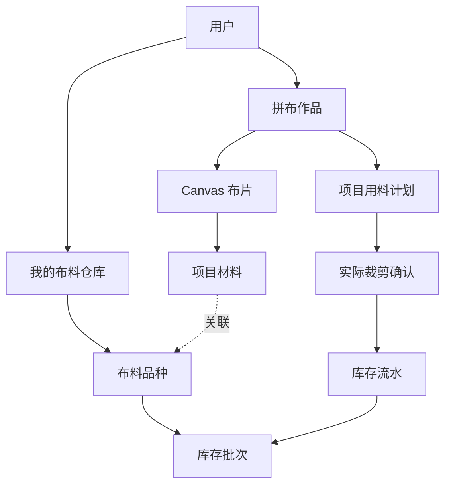
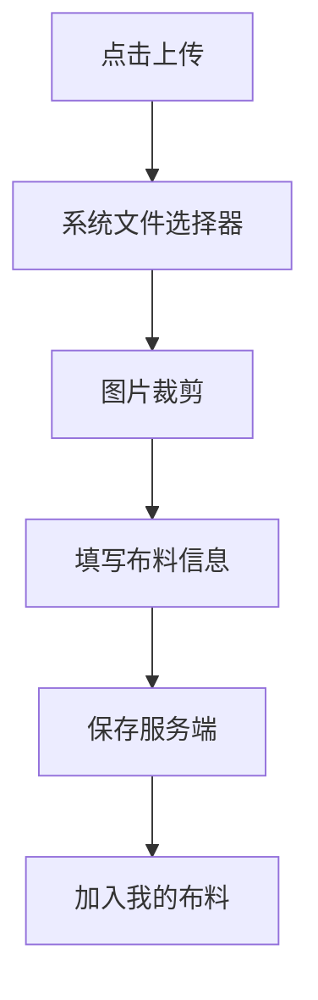
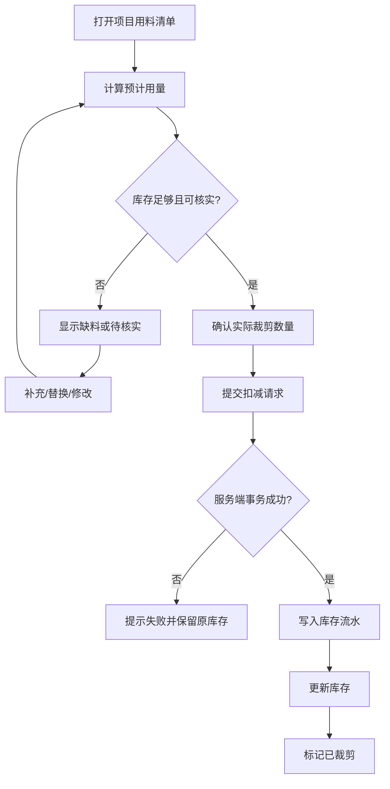

# 巧巧乐 · 拼布材料仓库与智能库存管理系统
## 产品需求文档（PRD）+ 技术设计文档 V1.0

**项目名称：** 巧巧乐 Qiaoqiaole\
**适用端：** H5，兼容移动端与桌面端\
**功能范围：** 拼布编辑器、我的布料仓库、项目用料清单、库存管理\
**开发目标：** 实现从布料上传、作品设计、缺料提醒到实际制作扣减库存的完整闭环\
**文档状态：** 待开发评审

---

# 一、项目背景

## 1.1 当前功能

巧巧乐现有拼布模块已经包含：

- Canvas 拼布编辑器
- 基础形状和我的形状
- 上传图片生成线稿
- 添加、移动、缩放、旋转布片
- 底布设置
- 布料纹理填充
- 统一布料选择器
- 作品保存和编辑
- 撤销、重做
- 拼布作品管理

目前存在以下业务缺口：

1. 用户无法集中管理自己真实拥有的布料。
2. 编辑器里的布料和真实库存没有建立可靠关联。
3. 设计时无法知道某种布料是否拥有。
4. 无法根据作品自动统计布料需求。
5. 完成作品后不能记录实际消耗。
6. 无法查看剩余布料及历史使用情况。

## 1.2 项目目标

建立用户级的布料管理系统，让用户能够：

1. 上传并管理真实拥有的布料。
2. 设计时直接使用自己的布料。
3. 自动识别作品中缺少的布料。
4. 根据 Canvas 几何形状计算理论耗料。
5. 在实际裁剪后确认扣减库存。
6. 查看布料剩余量及消耗记录。
7. 在多个设备之间同步仓库和作品。

**核心原则：作品是设计数据，仓库是真实物料数据，只有确认实际使用后才改变库存。**

---

# 二、业务概念与数据关系

## 2.1 核心对象

系统包含六类主要业务对象。

| 对象 | 作用 |
|---|---|
| 我的布料 | 用户拥有的布料品种 |
| 库存批次 | 一种布料下实际拥有的布块、布卷或余料 |
| 项目材料 | 当前作品使用的布料及纹理快照 |
| 项目布片 | Canvas 上的具体形状和尺寸 |
| 用料计划 | 作品理论上需要的材料 |
| 库存流水 | 实际入库、扣减、退回和调整记录 |

## 2.2 数据关系



### 设计说明

一个布料品种可以拥有多个库存批次。

例如：

「粉色碎花棉布」可以包含：

- 100 × 150 cm 的整块布
- 40 × 60 cm 的余布
- 20 × 20 cm 的碎布

这些材料可以属于同一种花色，但不能简单合并成一块完整的布。

因此，**库存必须同时支持总面积和实际布块尺寸**。

---

# 三、用户使用流程

## 3.1 首次使用

用户进入：

**我的 → 我的布料 → 上传布料**

上传布料照片，填写基本信息，保存到个人仓库。

## 3.2 拼布设计

用户进入拼布编辑器：

1. 添加形状或导入图片生成线稿。
2. 选中布片。
3. 点击底部布料。
4. 从个人仓库选择布料。
5. 直接填充 Canvas 布片。
6. 继续调整形状、位置和尺寸。
7. 保存作品。

## 3.3 缺料检查

用户打开项目用料清单：

- 已有布料：正常显示。
- 未指定布料：灰色提示。
- 仓库没有的布料：红色提示。
- 库存数量不足：红色提示。
- 数量未知：显示待核实。

用户可以替换布料或补充库存。

## 3.4 实际制作

用户完成设计后：

1. 点击「用料清单」。
2. 查看理论耗料面积。
3. 确认缝份和损耗。
4. 点击「已裁剪，扣减库存」。
5. 核对实际使用数量。
6. 确认扣减。
7. 系统记录库存流水。

用户之后仍然可以修改设计，但不会因为保存作品而重复扣库存。

---

# 四、功能模块 A：我的布料仓库

## 4.1 页面入口

在「我的」页面增加：

**我的布料**

进入后展示当前用户的所有布料。

### 页面结构

顶部：

- 页面标题：我的布料
- 搜索框
- 上传按钮

内容区：

- 布料图片网格
- 布料名称
- 库存状态
- 剩余数量

筛选项：

- 全部
- 有库存
- 库存不足
- 已用完

不需要复杂的多层导航。

## 4.2 上传布料

点击「上传布料」后直接打开系统图片选择器。

不增加没有必要的中间弹窗。

支持：

- JPG
- PNG
- WebP
- 手机相册
- 手机拍照
- 桌面文件选择

上传后进入布料信息编辑页面。

### 布料字段

| 字段 | 必填 | 说明 |
|---|---|---|
| 图片 | 是 | 布料纹理照片 |
| 名称 | 是 | 如粉色碎花 |
| 主色 | 否 | 自动识别，可手动修改 |
| 分类 | 否 | 棉布、麻布、其他 |
| 库存方式 | 是 | 面积、尺寸或仅记录拥有 |
| 长度 | 条件必填 | 单位 mm |
| 宽度 | 条件必填 | 单位 mm |
| 数量 | 条件必填 | 块数 |
| 备注 | 否 | 购买来源等 |

### 上传流程



## 4.3 图片处理

上传时建议自动生成：

- 原图
- 缩略图
- 适合 Canvas 重复平铺的纹理图
- 主色值

纹理图片必须保持合理清晰度，避免 Canvas 放大后严重模糊。

对于照片边缘、阴影和光照不均匀问题，V1 提供手动裁剪即可。

自动无缝纹理处理放到后续版本。

## 4.4 布料详情

每款布料支持：

- 查看大图
- 编辑名称
- 修改库存
- 新增库存批次
- 查看消耗历史
- 删除或归档

如果该布料已被作品引用，删除时需要提示。

采用软删除，不直接破坏历史作品。

---

# 五、功能模块 B：统一布料选择器

## 5.1 核心要求

拼布编辑器所有布料选择入口必须共用同一个组件。

包括：

- 底部布料栏
- 布片属性中的更换布料
- 底布材料选择
- 缺料替换
- 项目用料调整

建议组件：

`FabricPicker`

## 5.2 数据来源

普通选布列表默认只显示：

**当前用户仓库中拥有且可使用的布料。**

不显示其他用户的私有布料。

不把系统示例纹理当作用户真实拥有的库存。

## 5.3 交互要求

### 布片填充

1. 用户选中一个或多个布片。
2. 点击底部某款布料。
3. 立即更新所选布片纹理。
4. 记录 Canvas 撤销历史。

无需再次点击「确定」。

### 底布设置

点击底布材料按钮，打开同一个布料选择器。

选择后立即更新底布。

### 空仓库

如果用户没有上传布料：

显示空状态：

「还没有布料，先上传你拥有的布料」

提供「上传布料」按钮。

## 5.4 搜索与排序

支持：

- 名称搜索
- 最近使用
- 最近上传
- 收藏
- 主色筛选

V1 可以优先实现搜索和最近使用。

## 5.5 选择时的库存判断

普通列表显示有库存的布料。

对于数量未知的布料，允许选择，但显示「数量待核实」。

已经用完的布料不出现在普通可用列表；可以通过仓库管理页面查看。

---

# 六、功能模块 C：项目缺料提醒

## 6.1 状态定义

```ts
type FabricAvailability =
  | 'available'
  | 'unassigned'
  | 'missing'
  | 'insufficient'
  | 'unknown';
```

| 状态 | 含义 | UI |
|---|---|---|
| available | 仓库存在且预计够用 | 正常 |
| unassigned | 布片没有指定布料 | 灰色 |
| missing | 仓库没有对应布料 | 红色 |
| insufficient | 仓库库存预计不够 | 红色 |
| unknown | 无法确认数量或可裁剪性 | 灰色提示 |

## 6.2 画布显示

当布片关联缺失布料时：

- 保留原有布料纹理。
- 增加红色警示边框。
- 在适当位置显示缺料图标。
- 点击布片可查看缺料原因。

不要直接把布片整体改为红色。

原因是红色覆盖会影响用户判断原来的花纹和设计效果。

## 6.3 项目用料清单

新增「用料清单」入口。

显示当前项目使用的布料：

| 布料 | 布片数量 | 预计用量 | 状态 |
|---|---:|---:|---|
| 粉色碎花 | 8 | 2,400 cm² | 已有 |
| 绿色棉布 | 5 | 1,600 cm² | 已有 |
| 蓝色格纹 | 3 | 900 cm² | 缺少 |

点击缺料项后可以：

- 从我的布料替换
- 补充对应布料库存
- 暂时忽略并继续设计

替换时支持：

- 只替换当前布片
- 替换项目中全部使用该材料的布片

替换必须进入 Canvas 撤销历史。

## 6.4 缺料判断规则

缺料判断以仓库布料 ID 为准。

不能因为两个布料名称相同，就认为是同一种布料。

不能因为颜色相似，就认为仓库已有。

对于未指定布料的布片，不直接判定为缺料。

---

# 七、功能模块 D：Canvas 用料面积计算

## 7.1 计算基础

Canvas 中的布片由毫米坐标的多边形表示。

可以直接使用鞋带公式计算面积：

\[
A=\frac12\left|\sum_{i=1}^{n}(x_i y_{i+1}-x_{i+1}y_i)\right|
\]

其中：

- x、y：多边形顶点坐标，单位 mm
- A：面积，单位 mm²

转换为 cm²：

\[
A_{cm^2}=\frac{A_{mm^2}}{100}
\]

## 7.2 布片面积

每个布片应计算：

1. 净形状面积
2. 加缝份后的裁片面积
3. 预计损耗面积

### 净形状面积

指 Canvas 上布片轮廓围成的面积。

### 裁片面积

指考虑缝份后实际需要裁剪的轮廓面积。

例如一个 100 × 100 mm 的正方形，四周各增加 5 mm 缝份：

净面积：

\[
100\times100=10000\ mm^2
\]

裁片面积：

\[
110\times110=12100\ mm^2
\]

即 121 cm²。

**不能简单将净面积乘以一个统一缝份系数。**

对于凹多边形、复杂曲线和带孔形状，需要正确计算裁剪轮廓的偏移区域。

## 7.3 缝份处理

沿用当前拼布项目已有的缝份字段。

根据不同工艺处理：

- 不需要缝份：直接使用净面积。
- 需要缝份：生成偏移后的裁片轮廓。
- 复杂形状偏移失败：标记需要人工核实。

不能在计算失败时悄悄返回一个看似精确的面积。

## 7.4 预计损耗

V1 允许用户设置损耗比例。

建议默认值：15%，仅作为可修改的估算参数，不代表所有布料的真实损耗率。

公式：

\[
A_{estimate}=A_{cut}\times(1+r)
\]

其中：

- A_cut：裁片总面积
- r：用户设置的损耗率

### 示例

| 项目 | 面积 |
|---|---:|
| 净布片面积 | 2,000 cm² |
| 加缝份后 | 2,300 cm² |
| 预计损耗 15% | 345 cm² |
| 预计备料面积 | 2,645 cm² |

这个结果用于估算备料量。

实际扣库存时，应允许用户按真实消耗修改。

## 7.5 特殊情况

需要明确处理：

- 自交多边形
- 带孔洞图形
- 不闭合轮廓
- 面积过小的图形
- 旋转后的图形
- 超出底布范围的图形
- 多个图形相互重叠

对于旋转，刚性旋转不改变面积。

对于多个独立裁片，即使它们在画布上重叠，也应分别统计各自的裁剪需求，不能直接计算视觉并集面积。

辅助线、参考图不参与布料面积计算。

底布是否计入用料，应作为独立选项。

---

# 八、功能模块 E：库存管理

## 8.1 库存单位

建议数据库内部统一使用：

- 长度：mm
- 面积：mm²
- 数量：整数块数

界面可以展示：

- cm
- m
- cm²
- m²
- 块

避免浮点数反复换算造成库存误差。

## 8.2 库存模式

### 模式一：仅记录拥有

用户只上传图片，不填写数量。

状态：

「已有，数量未知」

允许用于设计，但不能自动确认足量。

### 模式二：面积库存

例如：

粉色碎花布：12,000 cm²

适合粗略管理总库存。

### 模式三：布块尺寸库存

例如：

- 100 × 150 cm，1 块
- 40 × 60 cm，2 块
- 20 × 30 cm，3 块

适合更准确地管理布料和余料。

## 8.3 库存扣减

扣减只发生在用户确认实际裁剪后。

系统根据当前作品生成建议消耗量。

用户可以：

- 使用系统估算值
- 修改实际使用量
- 选择消耗的库存批次
- 选择暂不扣减

服务端负责执行库存扣减。

## 8.4 库存不足

如果库存不足：

- 红色显示缺少数量
- 不自动产生负库存
- 不允许未经处理就完成正式扣减

提供处理方式：

- 补充库存
- 修改实际消耗
- 更换布料
- 暂不扣减

## 8.5 余料

V1 采用面积余额记录。

例如：

原库存 10,000 cm²，实际消耗 2,000 cm²，剩余 8,000 cm²。

但要明确：

**剩余面积不代表剩余布料一定能够裁出任何指定形状。**

V2 再增加余料的具体形状、尺寸和裁剪排版功能。

---

# 九、功能模块 F：完成作品与库存扣减

## 9.1 保存与完成分离

必须区分：

| 操作 | 是否扣库存 |
|---|---|
| 保存草稿 | 否 |
| 保存作品 | 否 |
| 标记设计完成 | 否 |
| 查看用料清单 | 否 |
| 生成预计用料 | 否 |
| 确认已裁剪 | 是 |
| 取消库存扣减 | 产生反向库存流水 |

不要在普通保存操作中自动扣减库存。

## 9.2 项目状态

建议采用两个独立状态维度。

设计状态：

```ts
type DesignStatus =
  | 'draft'
  | 'ready'
  | 'archived';
```

制作状态：

```ts
type ProductionStatus =
  | 'not_started'
  | 'cutting'
  | 'cut'
  | 'finished';
```

这样用户可以设计完成但尚未制作，也可以已经裁剪但还没有完成缝制。

## 9.3 扣减确认流程



## 9.4 防止重复扣减

必须实现幂等性。

同一次裁剪操作生成唯一 `operationId`。

重复提交相同 `operationId` 时：

- 不再次扣库存
- 返回之前的操作结果

前端按钮禁用不能替代服务端幂等校验。

## 9.5 修改已裁剪作品

已经扣库存的作品仍允许修改设计。

但是：

- 编辑 Canvas 不直接改变历史库存流水。
- 新增裁剪需求必须创建新的扣减记录。
- 已退回的材料通过库存返还记录处理。
- 不能简单重新扣减整个作品的总面积。

## 9.6 撤销库存扣减

Canvas 的撤销和库存操作的撤销是两个不同概念。

Canvas 撤销：

恢复图形编辑历史。

库存撤销：

必须由服务端执行一笔反向流水。

例如：

原扣减：-2,000 cm²

撤销记录：+2,000 cm²

原始流水仍然保留，便于审计。

如果已裁剪材料无法恢复成原始整块布，则不应简单返还原批次。用户应确认是录入错误，还是要将真实余料重新入库。

---

# 十、数据库设计

建议使用现有服务端数据库，新增以下数据结构。

## 10.1 `user_fabrics`

用户布料品种表。

| 字段 | 类型 |
|---|---|
| id | UUID |
| user_id | String |
| name | String |
| image_asset_id | String |
| thumbnail_asset_id | String |
| dominant_color | String |
| category | String |
| stock_mode | Enum |
| favorite | Boolean |
| deleted_at | Timestamp / Null |
| created_at | Timestamp |
| updated_at | Timestamp |

建立 `(user_id, deleted_at)` 等必要索引。

## 10.2 `fabric_stock_lots`

库存批次表。

| 字段 | 类型 |
|---|---|
| id | UUID |
| user_id | String |
| fabric_id | UUID |
| lot_type | Enum |
| width_mm | Integer / Null |
| length_mm | Integer / Null |
| quantity | Integer / Null |
| available_area_mm2 | Integer / Null |
| stock_unknown | Boolean |
| version | Integer |
| created_at | Timestamp |
| updated_at | Timestamp |

`lot_type`：

- whole：整块布
- roll：布卷
- remnant：余料
- area_only：仅面积记录

`version` 用于并发库存更新控制。

## 10.3 `project_materials`

项目材料快照。

| 字段 | 类型 |
|---|---|
| id | UUID |
| project_id | UUID |
| inventory_fabric_id | UUID / Null |
| name_snapshot | String |
| color_snapshot | String |
| texture_asset_id | String / Null |
| created_at | Timestamp |

项目布片通过 `materialId` 引用项目材料。

项目材料通过 `inventory_fabric_id` 关联个人仓库。

历史项目必须保留纹理快照。

## 10.4 `project_fabric_requirements`

项目用料计划。

| 字段 | 类型 |
|---|---|
| id | UUID |
| project_id | UUID |
| material_id | UUID |
| piece_count | Integer |
| net_area_mm2 | Integer |
| cut_area_mm2 | Integer |
| estimated_area_mm2 | Integer |
| waste_rate | Decimal |
| calculation_version | String |
| project_revision | String |
| updated_at | Timestamp |

该表属于可重算的计划数据。

每次影响耗料的项目编辑完成后，可以更新计算结果。

## 10.5 `fabric_stock_transactions`

库存流水。

| 字段 | 类型 |
|---|---|
| id | UUID |
| user_id | String |
| fabric_id | UUID |
| stock_lot_id | UUID |
| project_id | UUID / Null |
| operation_id | UUID |
| transaction_type | Enum |
| delta_area_mm2 | Integer / Null |
| delta_quantity | Integer / Null |
| note | String / Null |
| reversed_transaction_id | UUID / Null |
| created_at | Timestamp |

交易类型：

- stock_in
- consumption
- return
- adjustment
- reversal

库存流水原则上不可直接修改或删除。

## 10.6 `project_cutting_operations`

裁剪确认记录。

| 字段 | 类型 |
|---|---|
| id | UUID |
| user_id | String |
| project_id | UUID |
| operation_id | UUID |
| project_revision | String |
| status | Enum |
| confirmed_at | Timestamp |
| reversed_at | Timestamp / Null |

建立 `operation_id` 唯一约束，确保重复请求不会重复扣减。

---

# 十一、API 设计

## 11.1 我的布料

```http
GET /api/my/fabrics
POST /api/my/fabrics
GET /api/my/fabrics/:id
PATCH /api/my/fabrics/:id
DELETE /api/my/fabrics/:id
```

列表支持：

- page
- pageSize
- keyword
- category
- stockStatus
- sort

## 11.2 布料图片

```http
POST /api/my/fabrics/upload
```

需要：

- 文件类型检查
- 文件大小限制
- 服务端文件内容校验
- 用户权限检查
- 缩略图生成
- 对象存储上传

## 11.3 库存批次

```http
GET /api/my/fabrics/:id/lots
POST /api/my/fabrics/:id/lots
PATCH /api/my/fabrics/:id/lots/:lotId
```

库存增减应通过库存操作接口处理，不能允许客户端直接随意覆盖已核算的库存余额。

## 11.4 项目用料

```http
GET /api/projects/:id/fabric-requirements
POST /api/projects/:id/fabric-estimate
```

示例响应：

```json
{
  "projectId": "project-001",
  "projectRevision": "revision-12",
  "materials": [
    {
      "materialId": "material-001",
      "fabricId": "fabric-001",
      "pieceCount": 8,
      "netAreaMm2": 200000,
      "cutAreaMm2": 230000,
      "estimatedAreaMm2": 264500,
      "availability": "available"
    }
  ],
  "missingCount": 0,
  "insufficientCount": 0
}
```

## 11.5 扣减库存

```http
POST /api/projects/:id/confirm-cutting
```

请求示例：

```json
{
  "operationId": "unique-operation-id",
  "projectRevision": "revision-12",
  "items": [
    {
      "fabricId": "fabric-001",
      "stockLotId": "lot-001",
      "actualAreaMm2": 260000
    }
  ]
}
```

服务端必须验证：

1. 当前登录用户有权限访问该项目。
2. 所有布料及库存批次属于该用户。
3. 项目版本与确认时一致。
4. 库存余额足够。
5. 该操作未重复提交。
6. 所有库存修改和流水写入在同一个事务中成功。

如果版本已变化，返回冲突并要求重新确认用量。

## 11.6 撤销扣减

```http
POST /api/projects/:id/cutting-operations/:operationId/reverse
```

需要校验：

- 原操作存在
- 尚未撤销
- 当前用户有权限
- 返还目标库存批次合理

---

# 十二、前端技术设计

## 12.1 目录建议

基于当前 H5 项目结构，建议：

```text
apps/h5/src/
├── patchwork/
│   ├── PatchworkPage.tsx
│   ├── FabricPicker.tsx
│   ├── FabricRequirementsPanel.tsx
│   ├── FabricConsumptionDialog.tsx
│   ├── fabricArea.ts
│   ├── fabricAvailability.ts
│   └── hooks/
│       ├── useFabricInventory.ts
│       └── useFabricRequirements.ts
│
├── fabrics/
│   ├── MyFabricsPage.tsx
│   ├── FabricUpload.tsx
│   ├── FabricDetail.tsx
│   ├── FabricStockLots.tsx
│   └── FabricTransactions.tsx
```

具体文件名可根据当前代码结构调整，不要求为了匹配文档强行拆分。

## 12.2 组件职责

### FabricPicker

只负责：

- 查询可选布料
- 搜索
- 展示缩略图
- 返回选中布料

不直接负责 Canvas 状态管理。

### FabricRequirementsPanel

负责：

- 展示项目用料
- 缺料状态
- 库存不足状态
- 布料替换入口

### FabricConsumptionDialog

负责：

- 展示预计耗料
- 修改实际消耗
- 选择库存批次
- 提交扣减
- 展示失败原因

### fabricArea.ts

负责：

- 多边形面积计算
- 缝份轮廓计算
- 面积单位转换
- 理论耗料汇总

面积算法应是独立的纯函数，便于单元测试。

## 12.3 状态管理

区分三种状态：

**Canvas 编辑状态**

布片、形状、材料、撤销历史。

**用户仓库状态**

用户布料、库存批次、库存余额。

**项目用料状态**

当前项目需求、缺料、预计用量。

Canvas 操作不应直接修改真实库存。

库存只能通过服务端业务操作更新。

## 12.4 数据缓存

可以使用前端缓存改善选布性能。

但库存余额的最终结果以服务端为准。

当用户上传、修改、删除或扣减布料后，需要刷新对应仓库数据。

避免出现：

- 编辑器显示有库存
- 服务端已经没有库存
- 用户仍然能够重复扣减

---

# 十三、现有项目兼容与迁移

## 13.1 兼容已有材料结构

现有拼布项目已经有材料和布片的引用关系。

建议保留：

- `materials`
- `materialId`
- `assetId`
- `pieces`
- `reference`
- `guides`

在项目材料中增加仓库布料关联。

不要直接用仓库布料 ID 替代全部项目材料 ID。

## 13.2 历史作品

历史作品可能使用系统示例纹理。

迁移时：

- 保留原材料和纹理。
- 默认标记为未关联仓库。
- 不自动认定用户拥有这些布料。
- 不自动扣减库存。
- 允许用户手动关联仓库中的布料。

## 13.3 图片生成线稿

生成的形状继续保存到「我的形状」。

形状本身不应自动绑定库存布料。

用户把形状放到 Canvas 后再选择实际布料。

## 13.4 数据一致性

迁移过程中需要兼容旧项目的读取和保存。

任何数据库迁移前应先备份现有项目数据。

---

# 十四、权限与安全

## 14.1 用户隔离

所有布料、库存批次和库存流水必须绑定用户身份。

服务端不能信任客户端提交的 `userId`。

## 14.2 权限验证

每个涉及布料的 API 都要验证：

- 用户已登录
- 资源属于该用户
- 项目归属合法
- 引用的布料有访问权限

## 14.3 并发控制

库存扣减必须使用数据库事务和行级锁或等效并发控制。

不能采用：

先查询库存 → 前端计算 → 直接覆盖余额

这种方式容易造成并发扣减错误。

## 14.4 上传安全

图片上传必须限制：

- MIME 类型
- 文件大小
- 实际文件格式
- 图片尺寸
- 上传频率

私有布料图片需要适当的访问控制。

---

# 十五、异常处理

| 场景 | 处理方式 |
|---|---|
| 图片上传失败 | 保留表单信息，允许重试 |
| 布料列表加载失败 | 显示错误，不误报仓库为空 |
| 仓库没有布料 | 显示上传入口 |
| 布料被删除 | 保留项目纹理，标红缺料 |
| 库存数量未知 | 显示待核实 |
| 面积计算失败 | 禁止使用错误结果自动扣减 |
| 库存不足 | 提示缺少量，不允许默认负库存 |
| 重复点击扣减 | 通过 operationId 幂等处理 |
| 网络超时 | 查询操作状态，不直接重新扣减 |
| 多设备同时扣减 | 服务端事务保证一致性 |
| 项目版本已改变 | 要求重新核对用料 |
| 撤销库存失败 | 保留原记录并提示处理 |
| 上传照片无法平铺 | 允许手动裁剪或更换纹理 |

---

# 十六、测试与验收标准

## 16.1 布料仓库

- [ ] 用户能够上传布料图片。
- [ ] 上传后保存到服务端。
- [ ] 刷新页面后数据不丢失。
- [ ] 同一账号跨设备可访问。
- [ ] 不同账号数据隔离。
- [ ] 支持编辑和删除。
- [ ] 支持库存批次。

## 16.2 编辑器

- [ ] 底部只显示自己可用的布料。
- [ ] 选中布片后点击布料立即填充。
- [ ] 底布使用统一选择器。
- [ ] 仓库为空时显示正确空状态。
- [ ] 缺失布料红色提醒。
- [ ] 未指定布料不误报缺料。
- [ ] 替换布料支持撤销。
- [ ] 旧项目正常加载。
- [ ] 旧项目纹理不丢失。

## 16.3 面积计算

- [ ] 正方形面积正确。
- [ ] 三角形面积正确。
- [ ] 凹多边形面积正确。
- [ ] 旋转前后面积一致。
- [ ] 多个独立裁片分别统计。
- [ ] 缝份面积计算正确。
- [ ] 不闭合或非法图形得到明确错误。
- [ ] 参考图和辅助线不参与计算。
- [ ] 单位换算正确。

## 16.4 库存扣减

- [ ] 保存草稿不扣库存。
- [ ] 标记设计完成不扣库存。
- [ ] 只有确认已裁剪才扣库存。
- [ ] 可以修改实际消耗量。
- [ ] 库存不足不会自动变成负数。
- [ ] 重复请求不会重复扣减。
- [ ] 两设备并发操作不会超扣。
- [ ] 库存流水完整。
- [ ] 撤销操作产生反向流水。
- [ ] 修改已裁剪作品不会重复扣全量。
- [ ] 扣减失败时库存和流水保持一致。

---

# 十七、开发阶段划分

## 第一阶段：布料仓库基础功能（P0）

目标：让用户可以真正管理自己拥有的布料。

开发内容：

1. 数据库表和服务端接口。
2. 布料图片上传。
3. 我的布料页面。
4. 布料信息编辑。
5. 布料列表搜索。
6. 统一 FabricPicker。
7. Canvas 使用真实仓库布料。

验收目标：

用户上传布料后，可以在拼布编辑器中直接使用，并且跨设备同步。

## 第二阶段：项目用料与缺料提醒（P0）

目标：让用户知道当前作品需要哪些布料。

开发内容：

1. 项目材料关联。
2. 缺料状态计算。
3. Canvas 红色提醒。
4. 项目用料清单。
5. 缺料替换。
6. 历史项目兼容。

验收目标：

作品缺少布料时能够准确标红，用户可以快速替换。

## 第三阶段：面积计算与库存扣减（P1）

目标：完成设计到实际库存消耗的闭环。

开发内容：

1. Canvas 面积计算。
2. 缝份面积计算。
3. 损耗估算。
4. 库存批次。
5. 裁剪确认界面。
6. 服务端库存扣减。
7. 库存流水。
8. 幂等与并发保护。
9. 撤销库存操作。

验收目标：

用户确认已裁剪后，库存准确减少，重复操作不会重复扣减。

## 第四阶段：智能裁剪与余料优化（P2）

目标：提高实际布料利用率。

开发内容：

1. 布片自动排版。
2. 布料方向约束。
3. 余料形状记录。
4. 余料再次使用。
5. 智能推荐替代布料。
6. 裁剪布局预览。

此阶段不应阻塞前面三个阶段上线。

---

# 十八、非功能要求

## 18.1 性能

- 布料列表分页加载。
- 缩略图懒加载。
- 图片压缩与缓存。
- Canvas 编辑时避免重复请求库存。
- 面积计算采用增量更新或异步计算，避免大项目卡顿。
- 图片上传和库存接口需要明确超时与重试机制。

## 18.2 移动端

- 适配 iPhone Safari。
- 支持系统相册和拍照。
- 布料选择器适合触屏。
- 弹窗内容可滚动。
- 底部确认按钮不被系统安全区域遮挡。
- 不增加不必要的「下一步」操作。

## 18.3 可维护性

- 面积计算和库存逻辑分离。
- 前后端共用明确的数据契约。
- 使用版本化计算规则。
- 库存操作具有可追踪记录。
- 关键业务操作配备自动化测试。

---

# 十九、建议最终交互规范

### 我的布料

上传 → 编辑 → 保存

### 添加形状

点击形状 → 立即放到画布

### 填充布料

选中布片 → 点击已有布料 → 立即填充

### 导入线稿

点击导入 → 直接选择图片 → 调整识别结果 → 生成形状

### 缺料处理

查看缺料 → 选择已有布料 → 立即替换

### 库存扣减

查看用料 → 确认实际裁剪 → 扣减库存

**简单编辑操作尽量一步完成；涉及真实库存变化的操作必须明确确认。**

---

# 二十、最终交付清单

完成本项目后应交付：

1. 我的布料仓库页面。
2. 布料上传和管理功能。
3. 服务端布料存储及鉴权。
4. 统一布料选择器。
5. 项目材料关联机制。
6. Canvas 缺料红色提示。
7. 项目用料清单。
8. 多边形面积计算模块。
9. 缝份与损耗估算模块。
10. 库存批次管理。
11. 裁剪确认与库存扣减功能。
12. 库存流水及撤销机制。
13. 历史作品兼容方案。
14. 单元测试、接口测试和浏览器交互测试。
15. 数据库迁移及回滚方案。

## 最终产品目标

让巧巧乐从单纯的拼布设计工具，升级为：

**「设计拼布 → 选择真实布料 → 检查缺料 → 计算用量 → 实际裁剪 → 扣减库存 → 管理余料」的一体化拼布工具。**

第一版优先保证真实仓库、可靠关联和可确认的库存扣减，不追求一开始就自动计算精确裁剪排版。

库存准确性应优先于自动化程度。
